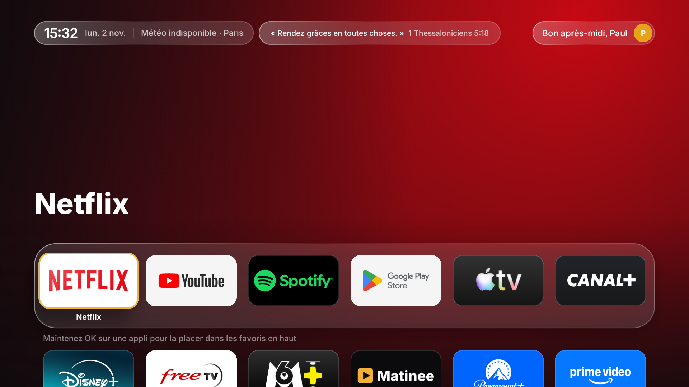
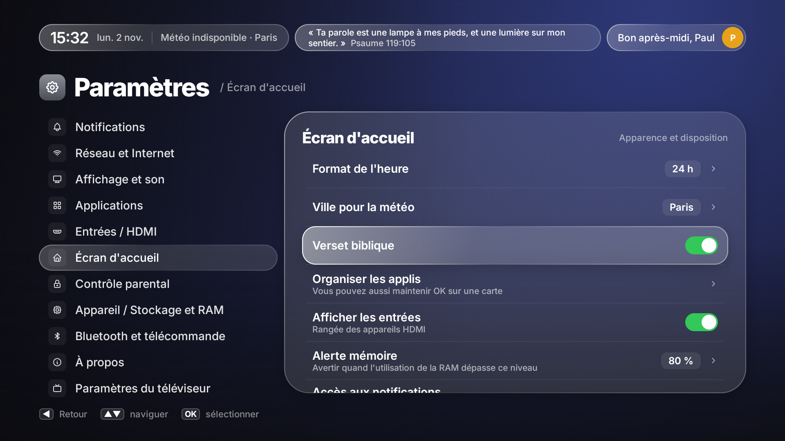
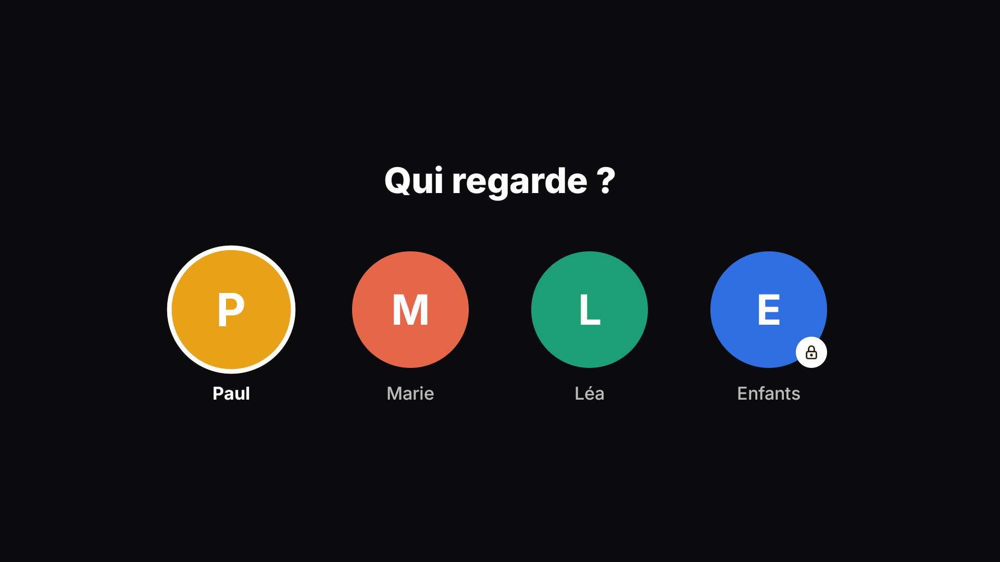
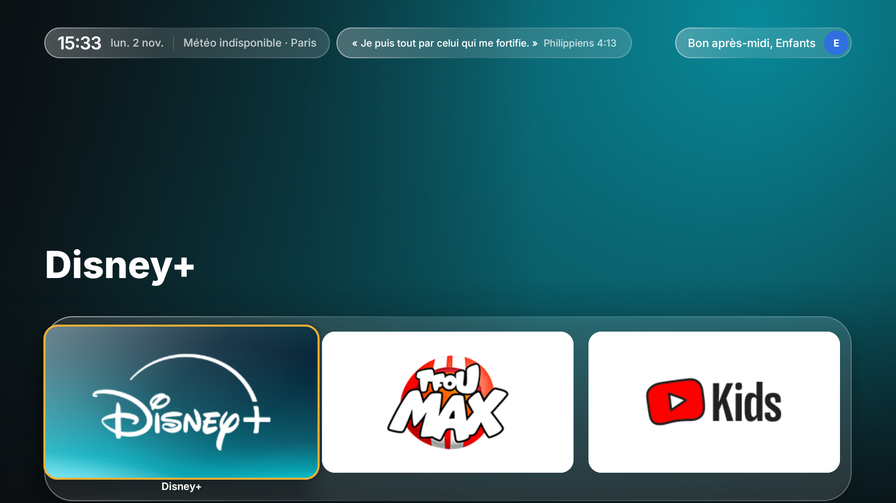

# Bible TV

Un écran d'accueil calme et sans publicité pour Android TV, avec **un verset biblique tiré au hasard** à côté de l'heure et de la météo.



---

## Un verset à chaque coup d'œil

Le verset est affiché en haut de l'écran d'accueil, juste après la ville de la météo.

- **Tiré au hasard** parmi 34 versets courts, avec la référence : Psaumes, Évangiles, Épîtres, Proverbes…
- **Toutes les 5 minutes, un nouveau verset.** Jamais deux fois le même d'affilée.
- **Louis Segond 1910**, une traduction du domaine public. Les versets sont dans l'application, donc **aucune connexion Internet n'est nécessaire**.
- **Pour toute la famille.** Il s'affiche aussi sur le profil Enfants.
- **On peut l'éteindre** dans **Paramètres → Accueil → Verset biblique**, juste sous la ville.

Les versets sont dans [`Verses.kt`](app/src/main/java/com/tcltv/sahne/data/Verses.kt). Pour en ajouter, il suffit d'une ligne `Verse("texte", "Livre chapitre:verset")`. Un test vérifie que chaque verset tient sur une ligne.



## Profils de la famille

- **« Qui regarde ? »** au démarrage et au réveil de la TV. Chaque personne retrouve son propre accueil : ses applis, son ordre et ses dossiers.
- **Profil Enfants** : seulement les applis choisies par les parents, sans TV en direct ni réglages. Pour quitter le profil, il faut le code parental. Les touches de la télécommande qui mèneraient ailleurs (chaînes, Netflix…) sont bloquées.
- **Code parental** pour créer, modifier ou supprimer un profil.

| Qui regarde ? | Accueil Enfants |
|---|---|
|  |  |

## Et aussi

- Uniquement **vos applis**, dans l'ordre que vous choisissez, avec la reprise de lecture.
- **Météo** de la ville de votre choix, et horloge.
- **Notifications** et **réseau** (nom du Wi‑Fi, test de débit) regroupés dans les Paramètres pour laisser la place au verset.
- **Mode performance extrême** pour les petits boîtiers.
- **Bouton Home** : un service d'accessibilité ramène sur Bible TV. Il se réactive tout seul après une mise à jour.
- Pas de compte, pas de publicité, pas de statistiques.

## Météo

La météo vient d'[Open-Meteo](https://open-meteo.com), un service gratuit qui ne demande ni compte ni clé. Il lui arrive d'être indisponible quelques minutes ou quelques heures. La pastille affiche alors **« Météo indisponible »** à côté de la ville, et Bible TV réessaie tout seul à l'intervalle choisi (Paramètres → Écran d'accueil → Mises à jour météo : 15, 30 ou 60 minutes). Il n'y a rien à faire : la température revient dès que le service répond. Les captures ci-dessus ont été prises pendant une de ces pannes.

## Appareils

| Appareil | |
|---|---|
| Android TV et Google TV (Android 8 ou plus récent) | Oui |
| Freebox Player POP | Oui, testé. L'accueil OQEE de Free est désactivé, pas supprimé, et peut être remis. |
| TV LG (webOS) | Pas directement : webOS n'installe pas d'applis Android. Branchez un boîtier Android TV ou Google TV sur la TV LG et installez Bible TV dessus. |

## Installer avec un agent IA

Donnez ce dépôt à votre agent IA (Claude Code, Codex, Cursor…) avec l'adresse IP de la TV :

> Installe Bible TV sur ma TV, son adresse IP est 192.168.1.50.

L'agent suit [AGENTS.md](AGENTS.md). Il vous demande les profils de la famille et la ville, vous dit quoi activer sur la TV, puis compile et installe tout seul. Vous n'avez que quelques réglages à faire à la télécommande : le mode développeur, autoriser l'ordinateur, le code parental.

## Installer à la main

Avec JDK 17 et le SDK Android (compile SDK 35, NDK 29 et CMake 3.31 pour le récepteur AirPlay) :

```bash
tools/install.sh 192.168.1.50
```

Sur une Freebox Player POP, ajoutez `--disable-free-launcher` pour couper l'accueil de Free. `tools/restore-free-launcher.sh 192.168.1.50` le remet.

### Votre famille et votre ville

Créez un fichier `family.properties` à la racine du projet. Il est ignoré par git et ne sera donc jamais publié.

```properties
profile.1=Paul|adult
profile.2=Marie|adult
profile.3=Enfants|child|com.google.android.youtube.tvkids,com.disney.disneyplus
city=Lyon|45.764|4.8357
```

- `adult` : accès à toutes les applis.
- `child` : uniquement les applis listées (noms de paquet séparés par des virgules).
- `city=` : nom de la ville, latitude et longitude pour la météo. Sans cette ligne, c'est Paris.

Ensuite, réglez le code parental dans **Paramètres → Contrôle parental**.

## Origine et licence

Bible TV est construit à partir de [Matinee](https://github.com/Jarvis322/matinee) de Yiğit Can Polat, sous licence [MIT](LICENSE). La licence d'origine est conservée.

Versets : Louis Segond 1910, domaine public.
